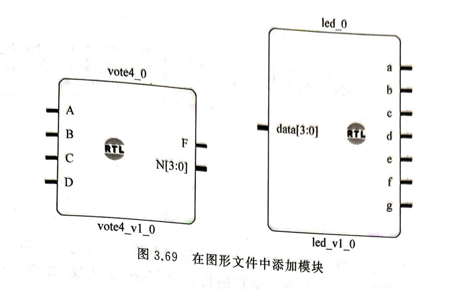
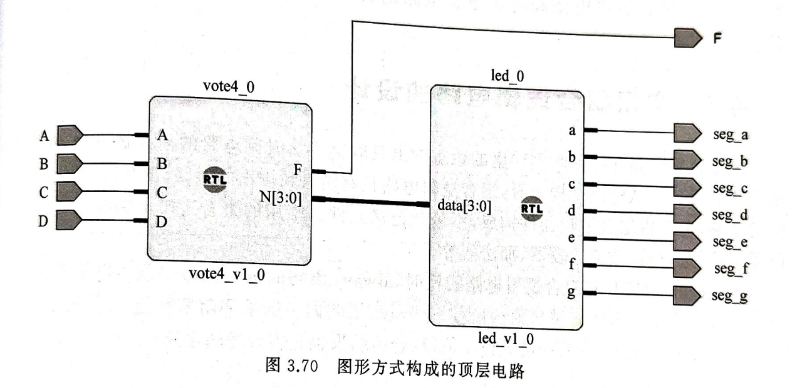

# Pitfalls——数字逻辑实验踩坑记录与工作流参考

**本文档由 AI 生成，在工作流中仅供参考，不作为强制约束。**

---

## 零、定位 Vivado 软件位置（为直接调用做准备）

使用

```powershell
Get-ItemProperty HKLM:\Software\Microsoft\Windows\CurrentVersion\Uninstall\* , HKCU:\Software\Microsoft\Windows\CurrentVersion\Uninstall\* | Where-Object { $_.DisplayName -like "*Vivado*" } | Select-Object DisplayName, InstallLocation, UninstallString
```

定位 Vivado 安装位置，例如返回的安装位置为 `E:\Vivado`，则 Vivado 二进制文件可能位于：`E:\Vivado\Vivado\2023.2\bin`（示例）。

## 一、出板前检查清单（参考）

按顺序过一遍，多数返工可以避免：

- [ ] **仿真**：波形显示的是具体数值而非 `X` / `Z`（`X`/`Z` 通常意味着信号没驱动或端口没连）
- [ ] **xdc 每条约束都有 PACKAGE_PIN + IOSTANDARD**——缺 IOSTANDARD 会触发 DRC NSTD-1，直接禁止生成位流（GUI 里 I/O Ports 面板那列显示 `default (LVCMOS18)` 就是缺失的信号）
- [ ] **每个引脚都能在 `Ports.md` 里查到**——凭印象编引脚号是最常见的错误来源
- [ ] **xdc 里的端口名与 Verilog 端口名逐字一致**（含大小写、位宽写法 `{in1[3]}`）
- [ ] xdc 开头有 `CFGBVS VCCO` / `CONFIG_VOLTAGE 3.3` 两行（消除 CFGBVS-1 警告）
- [ ] 综合、实现全程无 ERROR；**bit 文件的修改时间晚于最后一次源文件/约束修改**（防止拿着旧检查点以为改过了）
- [ ] Hardware Manager → Auto Connect 能枚举到 `xc7a35t`，Program Device 有成功提示

---

## 二、工作流参考

### 1. 代码与仿真（实验前）

模块名 / Testbench 写法参考 SKILL.md 的示例。几个容易忽略的点：

- 仿真里 `reg` 驱动输入、`wire` 接输出；`$finish` 前把要覆盖的取值都遍历到（如 sel 的 000~111 全部八种）。
- 波形窗口显示数字而非 X/Z 才算仿真通过；用 Fit zoom 缩放到合适尺度再截图。
- 输出位宽不足会静默截断（如把 8 位结果赋给 4 位端口），综合警告里会提，值得扫一眼。

### 2. 引脚分配（实验中）

推荐直接以 `Ports.md` 为唯一引脚来源逐条写 xdc。骨架：

```tcl
set_property CFGBVS VCCO [current_design]
set_property CONFIG_VOLTAGE 3.3 [current_design]

set_property -dict {PACKAGE_PIN <引脚> IOSTANDARD LVCMOS33} [get_ports <端口名>]
# 总线端口写法：[get_ports {in1[3]}]
# LED / 数码管段选等直驱输出可加 DRIVE 12
```

- 开关输入、LED/段选输出一律 `LVCMOS33`；**仅按键 FB1–FB12 用 `LVCMOS15`**。
- 想清楚位序约定再动手：推荐"开关编号递增 ↔ 端口下标递减"（SW2=in1[3] 最高位），这样拨码读出的二进制与数值一致；写进报告前在表格里体现出来。

### 3. 下载前批量验证（可选，但很省时间）

不开 GUI 也能完整验证"代码 + 约束能否出位流"，用批处理模式建临时工程跑一遍：

```tcl
# check.tcl —— 用法: vivado -mode batch -source check.tcl
create_project -force chk ./chk_proj -part xc7a35tfgg484-2
add_files -norecurse <顶层.v>
add_files -fileset constrs_1 -norecurse <约束.xdc>
set_property top <顶层模块名> [current_fileset]
update_compile_order -fileset sources_1

launch_runs impl_1 -to_step write_bitstream -jobs 4
wait_on_run impl_1
puts "STATUS: [get_property STATUS [get_runs impl_1]]"

# 逐端口读回落位，与 Ports.md 对照
open_run impl_1
foreach p [get_ports] {
    puts "$p -> [get_property PACKAGE_PIN $p] / [get_property IOSTANDARD $p]"
}
```

`STATUS: write_bitstream Complete!` 且每个端口落位正确，再去实验台上下载，基本一次过。临时工程用完即删。

### 4. 下载（实验中）

Run Synthesis → Run Implementation → Generate Bitstream → Open Hardware Manager → Open Target → Auto Connect → Program Device。

- 术语是"下载"（下载到 FPGA），不是"上传"。
- **严禁带电插拔实验箱导线**（课件原话）。

---

## 三、踩坑记录（真实案例）

每条按「现象 → 原因 → 处理」记录，出处都是本学期实际发生过的。

### 1. 位流生成失败：NSTD-1

- **现象**：`write_bitstream ERROR`，日志里 `DRC NSTD-1: 15 out of 15 logical ports use I/O standard 'DEFAULT'`。
- **原因**：xdc 里只写了 `PACKAGE_PIN`，一条 `IOSTANDARD` 都没有。
- **处理**：每条约束补上 `IOSTANDARD LVCMOS33`（或按键 FB 用 LVCMOS15）。GUI 的 I/O Ports 面板里 I/O Std 列显示红色 `default (LVCMOS18)` 即为缺失项。

### 2. 改了 xdc，DRC 错误依旧

- **现象**：明明把 IOSTANDARD 补进 xdc 了，重新 Generate Bitstream 还是报老错误。
- **原因**：Vivado 复用了旧的实现检查点，没有真正重跑。
- **处理**：Design Runs 里 Reset `impl_1`（连带清掉旧 bitstream）再重新 Implement → Generate Bitstream。改任何源文件/约束后都建议核对 bit 文件时间戳。

### 3. xdc 端口名与代码不一致

- **现象**：xdc 里写 `[get_ports en]`，代码里的端口实际叫 `en_xhx`——约束不生效或综合报找不到端口。
- **原因**：两个文件分开改、不同步。
- **处理**：写完 xdc 逐条与模块端口声明对照；用上面 check.tcl 的端口读回，一眼就能看出哪个端口没落位。

### 4. 编造引脚号

- **现象**：约束里出现 `PACKAGE_PIN D0`，引脚表里根本没有这个脚。
- **原因**：凭记忆/猜测填引脚。
- **处理**：每个引脚先在 `Ports.md` 查到再写。引脚表是唯一事实来源。

### 5. "下载后全黑"——其实是没连上

- **现象**：位流正常生成、Program Device 走完，数码管一片黑；反复怀疑代码和约束，改了一堆没用的。
- **原因**：物理连接问题（板子没上电 / USB 插在 UART 口而不是 JTAG 口 / 线只供电不传数据）。
- **处理**：**失败时先检查物理设备是否连接成功**——电源灯、JTAG 口、Auto Connect 能否枚举到 `xc7a35t`、Program Device 是否真的弹出成功提示。"没下载进去"和"逻辑写错了"的现象一模一样，先排除前者。

### 6. 数码管显示异常的排查顺序

- 全黑：先查位选（每位需要驱动，共阳位选通常给高电平；本实验台位选经 74LVC245 同相缓冲，`DIR` 接 3.3V、`/OE` 接地）
- 字形错乱：查段码位序——约定 `F[7]→SEG_A`、…、`F[0]→SEG_DP`（段码 a~g 按 `{a,b,c,d,e,f,g}` 排列时，a 在最高位）
- 亮但不对：共阳极段码 0 亮 1 灭；小数点是 `dp` 取反后送 h 段
- 多位同显/串扰：本实验台 DG1、DG2 的段脚是并联的，两模块永远显示同样内容；想让各位显示不同数字需要位选扫描（分频 + 轮流选通），那是后续实验的事

### 7. 报告里的引脚号笔误

- **现象**：报告实验现象一节写了"拨动开关 SW9~SW11"，但 sel 实际接在 SW10~SW12——与同文档的引脚分配表自相矛盾。
- **处理**：引脚号写进报告（或 xdc、或任何地方）之前，对照 `Ports.md` 核一遍。这类错误很隐蔽，因为读者默认作者不会写错自己的引脚表。

### 8. 外部修改 xdc 被 GUI 覆盖

- **现象**：脚本/编辑器刚写入的 xdc，几分钟后变成 0 字节或内容回退。
- **原因**：Vivado GUI 里开着该文件的编辑标签，其空/旧缓冲区被保存回去。
- **处理**：用外部工具改 xdc 时，先在 Vivado 里关掉该文件标签（提示保存时选"否"）；或者干脆只在一边改。

### 9. 两个 Vivado 进程同时开一个工程

- **现象**：run 状态互相打架、文件被另一个实例覆盖。
- **处理**：任务管理器确认只有一个 `vivado.exe` 在操作当前工程；批处理验证用独立的临时工程目录，不碰 GUI 正开着的工程。

---

## 四、硬件速查（配合 Ports.md）

- **平台**：ZDXH-EDA7A35，FPGA 为 xc7a35tfgg484-2（Artix-7），50MHz 时钟 SYS_CLK=W19。
- **拨动开关 SW1–SW16**：上=1，下=0，带 10K 上拉。
- **LED1–LED16**：FPGA 引脚经 1K 电阻直驱，高电平点亮。
- **数码管**：动态扫描八段数码管模块，共阳极；段选/位选均经 74LVC245 同相缓冲（无反相）；DG1 与 DG2 段选并联。
- **电平标准**：仅按键 FB1–FB12 为 LVCMOS15，其余一律 LVCMOS33。
- **下载口**：JTAG（USB 线插 JTAG 口，不是 UART 口）。


---

## 五、模块化设计指南

在用户的题目要求中包含“模块”、“用基本单元实现”...等关键词时，主动采用模块化设计实现题目。

### Example - 模块化设计 / 文本方式分配

**1. 划出最小单元。** 一个 20 位单元 `add3_shift`：输入 `din[19:0]`，输出 `dout[19:0]`。`din[19:8]` 是三位 BCD（百、十、个），`din[7:0]` 是尚未移入的二进制位。对三个 BCD 位各判断「大于 4 则加 3」，再整体左移一位，`din[7]` 顶进 BCD 的最低位。

**2. 顶层只做连线。** 另建 `bin_to_bcd` 作为顶层，例化 8 个单元。第一级 `din` 接 `{12'h000, bin}`，每级 `dout` 接下一级 `din`，第八级取 `[19:8]` 输出 `bcd[11:0]`。例化用名字关联（`.din()`、`.dout()`），改端口顺序时不易接错。顶层不写逻辑，只声明 `wire` 并串联，这与教材 led、vote_led 的分层写法一致。

**3. 位宽取 20 的理由。** 12 位 BCD 加 8 位二进制恰好 20 位，移位全程不必补位，最高位溢出直接丢弃。

**4. 约束文件要入库。** `bin[7:0]` 接 SW1~SW8（N15、P20、P16、R17、R16、P15、N17、P17），`bcd[11:0]` 接 LED1~LED12（W20、Y22、Y21、U21、T21、W21、W22、T20、AB18、AA18、AA19、AB20）。IOSTANDARD 用 LVCMOS33，LED 加 DRIVE 12，另设 `CFGBVS VCCO` 与 `CONFIG_VOLTAGE 3.3`。xdc 必须经 Add Sources 加入工程，只放目录里不会被读取，DRC 会报 NSTD-1 和 UCIO-1。

**5. 先穷举再综合。** 激励遍历 0~255，输出与 `{v/100, v%100/10, v%10}` 逐值比对，错误数为 0 再综合。

**6. 下载与读数。** 综合、实现、生成比特流、Open Hardware Manager、Auto Connect、Program Device。LED 每四位一组，依次读百位、十位、个位。

**关键点：** 加三只作用于 `din[19:8]` 这三个 BCD 位。判断写到 `din[7:0]` 一侧，全值域都会算错。

```verilog
// code.v
`timescale 1ns / 1ps

module bin_to_bcd(
    input [7:0] bin,
    output [11:0] bcd
    );
    wire [19:0] y1, y2, y3, y4, y5, y6, y7, y8;

    add3_shift u1 (.din({12'h000, bin}), .dout(y1));
    add3_shift u2 (.din(y1), .dout(y2));
    add3_shift u3 (.din(y2), .dout(y3));
    add3_shift u4 (.din(y3), .dout(y4));
    add3_shift u5 (.din(y4), .dout(y5));
    add3_shift u6 (.din(y5), .dout(y6));
    add3_shift u7 (.din(y6), .dout(y7));
    add3_shift u8 (.din(y7), .dout(y8));

    assign bcd = y8[19:8];
endmodule
```

```verilog
// add3_shitft.v
`timescale 1ns / 1ps

module add3_shift(
    input [19:0] din,
    output [19:0] dout
    );
    wire [3:0] b1 = (din[11:8]  > 4'd4) ? din[11:8]  + 4'd3 : din[11:8];
    wire [3:0] b2 = (din[15:12] > 4'd4) ? din[15:12] + 4'd3 : din[15:12];
    wire [3:0] b3 = (din[19:16] > 4'd4) ? din[19:16] + 4'd3 : din[19:16];
    assign dout = {b3, b2, b1, din[7:0]} << 1;
endmodule
```

### Guidance - 模块化设计

**3.4.7 层次化设计**

下面在四人表决器电路基础上，增加赞同同票数显示的功能，通过这个双模块电路的实现，学习基于 Vivado 软件的层次化设计过程。

**1. 通过 Verilog 实现层次化设计**

首先，新建设计文件 led.v 和 vote_led.v 文件，并修改 vote_led.v 代码，完整代码可以参考 3.3.7 节，输入完成后将 vote_led.v 文件设置为顶层。然后，新建仿真文件 led_sim.v 和 vote_led_sim.v，用于对 led.v 和 vote_led.v 模块仿真，工程中的文件结构如图 3.67 所示。

【图 3.67 工程中的文件结构】{Vivado 的 Sources 窗口截图，Design Sources (7) 节点下展开显示 vote_led.v、vote_led_test 等设计文件及 IP 核（IPJACT）；Constraints (1) 节点；Simulation Sources (3) 节点下 sim_1 (3) 中包含 vote_led_sim、led_sim、vote_led_s_sim 等仿真文件；Utility Sources 节点；窗口底部有 Hierarchy、Libraries、Compile Order 三个选项卡。}

仿真时，如果工程中存在多个仿真文件，需要将待仿真的文件设置为顶层后再进行仿真，操作是右击该文件，选择 Set as Top 即可。图 3.68 是对 led_sim.v 执行仿真后的波形图，仿真结果符合设计要求。

【图 3.68 带赞同票数显示的四人表决器仿真结果】{仿真波形图，左侧 Names/Value 栏中列出 s[3:0]、N[3:0] 以及 a、b、c、d、e、f、g 等信号及其当前数值；右侧为时间轴（0～600 ns）上的各信号波形，显示输入组合变化时输出 N[3:0] 与七段显示信号 a～g 的对应变化。}

验证通过后，就可以为输入/输出端口添加引脚约束，然后执行综合、实现及下载。

**2. 通过图形方式实现层次化设计**

展开主界面左侧 Flow Navigator 面板内的 IP Integrator 项，单击 Create Block Design 命令，创建一个扩展名为".bd"的图形设计文件。该图形文件相当于一个容器，可以通过添加 IP 或添加模块的方式把已有的设计添加进来，并通过连线实现互联，最终以图形的方式将电路结构呈现出来。

添加 IP 时，可以单击工具栏上的"+"，在弹出的 IP 库窗口中选择或搜索要添加的 IP，库中已包含了官方提供的各类 IP，可根据需要选用。此外，也可以将自己设计的模块封装成 IP 后再进行添加，这需要通过 Tools 下的 Create and Package New IP 工具完成，这种方式适合功能相对复杂的模块，且操作过程相对繁琐，这里不推荐使用，读者可自行查阅资料。

添加模块的方式比较方便，只需在 Design Sources 中找到要添加的模块，右击选择 Add Module to Block Design 就可将已设计的模块添加到设计文件中，添加完成后如图 3.69 所示。



剩下的操作就是将输入/输出端口引出，并完成内部信号的连接。内部信号连接只要将鼠标放在要连接的信号端口上，当出现一个笔状符号时，通过拖曳就可以完成连接。引出输入/输出端口的操作如下：用鼠标选中要引出的端口，右击选择 Make External 或 Create Port，对端口进行命名即可。最终设计完成的电路如图 3.70 所示。



图形文件设计完成之后，单击 Tools→Validate Design，检查图形设计是否有错误。如果报错，可根据提示进行修改，如果没有错误会弹出一个消息框，单击 OK 按钮将其关闭即可。

在 Sources 窗口中选中该图形文件，右击并选择 Create HDL Wrapper，在打开的对话框中选择第二项"Let Vivado manage Wrapper and auto-update"，表示让 Vivado 管理 wrapper 并自动更新。单击 OK，生成一个 HDL 文件，文件中代码包含了对图形文件的实例化调用，将该文件设置为顶层。之后就可以参考前面介绍的步骤，对设计文件进行仿真，综合、实现及下载了。