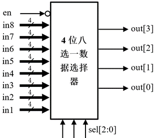
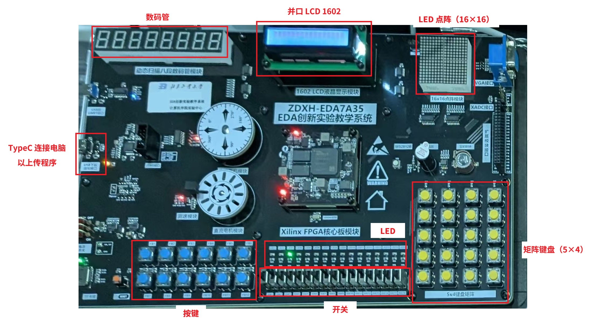

# 数字逻辑实验 Skill

本 Skill 整理了北京工业大学《数字逻辑实验》的相关资料和经验，以便使用 Agent 辅助处理完成实验。你可能需要协助用户完成实验前、实验中、实验后三部分的任务。

## 实验前

**Todo：完成实验预习报告、实验代码及仿真代码。**

若：

- 用户要求你编写 Verilog 程序实现，却未提供题目要求；
- 用户要求你编写仿真代码或分配引脚，但用户未完成 Verilog 程序或你不能理解用户的 Verilog 程序；
- 用户要求你完成实验报告，却未提供包含“实验要求”、“实验目的”的实验题目；

在以上三种情况下，请暂停 agent loop 或调用 Ask 类工具主动询问用户“老师在学习通上发布的题目要求是什么？请将题目要求截图或复制发送给我。”  
在用户给出题目的不能明确描述任务时，你可以请求用户将教材中的任务描述拍摄并发送给你。

### 要求

1. 编写的程序中禁止带有任何注释。  
2. 对程序的注解只允许在对话回复中向用户体现。  
    例如：回复用户“我修改了以下代码（附代码内容）”，而非在用户工程代码中添加 `// 修改：...`。
3. 恪守“最简”原则。在未经用户同意的情况下：禁止防御性编程，禁止添加多余调试文件或语句。
4. 在更改用户的工程文件前，确保你已经在你的工作区或临时文件夹备份了用户的原始工程文件。
5. 恪守“用户优先”原则。你应当辅助用户完成任务。在未经用户同意、或用户原始代码没有错误的情况下，禁止擅自修改用户已经完成的原始代码。
6. 在用户的题目要求中包含“模块”、“用基本单元实现”...等关键词时，主动采用模块化设计实现题目。具体方案参考 Pitfalls.md

流程如下：

- 创建项目时选择 RTL Project，底下两项打勾，然后 Part = xc7a35tfgg484-2，以“数据选择器的设计”为例：

  > 一、实验要求
  > 
  > 用Verilog实现一个4位八选一数据选择器，数据可以是个人学号、日期、时钟等有意义的数，采用8421 BCD码；通过控制数据选择端，将数据依次输出到LED灯上。
  > 
  > 
  > 
  > 二、实验目的
  > 
  > (1) 熟悉parameter参数化设计。
  > 
  > (2) 进一步熟悉硬件下载过程。
  > 
  > (3) 学习用文本方式分配引脚。
  > 
  > (4) 熟悉LED硬件电路原理及引脚分配。
  > 
  > 三、预习内容
  > 
  > (1) 阅读教材6.1.2节任务3内容（P160~P161），了解实验内容。
  > 
  > (2) 阅读教材2.3.5节（P23），了解parameter参数的使用。
  > 
  > (3) 文本方式分配引脚见P90。

  1. 左侧 Project Manager - Add Source, 选第二个 create design resources，新建文件，内容为 Verilog 程序，实现相关逻辑，例如：

      ```verilog
      module code_by_25070000(
          input en_naiwa,
          input [3:0]in2,
          input [3:0]in1,
          input [2:0]sel,
          output [3:0]f
          );
        parameter year = 16'h2026, month = 8'h11;
        wire [3:0] in8 = year[15:12], in7 = year[11:8], in6 = year[7:4], in5 = year[3:0];
        wire [3:0] in4 = month[7:4], in3 = month[3:0];
        reg [3:0] f;
        always @(*) begin
          if (en_naiwa) f = 0;
          else begin
          case (sel)
            3'b000: f = in1;
            3'b001: f = in2;
            3'b010: f = in3;
            3'b011: f = in4;
            3'b100: f = in5;
            3'b101: f = in6;
            3'b110: f = in7;
            3'b111: f = in8;
            default: f = 0;
          endcase
          end
        end
      endmodule
      ```

      Note：部分情况下、要求使用真实姓名 / 学号作为变量 / 模块名，若用户未明确要求这样做、则无需。

  2. 同样 Add Source，然后选第三个 simulation sources

      ```verilog
      `timescale 1ns / 1ps

      module code_tb();

          reg en_naiwa;
          reg [3:0] in2;
          reg [3:0] in1;
          reg [2:0] sel;
          wire [3:0] f;

          code_by_25070000 uut (
              .en_naiwa(en_naiwa), 
              .in2(in2),
              .in1(in1),
              .sel(sel),
              .f(f)
          );

          initial begin
              in1 = 4'd8;
              in2 = 4'd2;

              en_naiwa = 1'b1; sel = 3'b000; #10;
              en_naiwa = 1'b0; sel = 3'b000; #10;
              en_naiwa = 1'b0; sel = 3'b001; #10;
              en_naiwa = 1'b0; sel = 3'b010; #10;
              en_naiwa = 1'b0; sel = 3'b011; #10;
              en_naiwa = 1'b0; sel = 3'b100; #10;
              en_naiwa = 1'b0; sel = 3'b101; #10;
              en_naiwa = 1'b0; sel = 3'b110; #10;
              en_naiwa = 1'b0; sel = 3'b111; #10;

              $finish;
          end

      endmodule
      ```

- 右键 Design Sources 中的代码文件，确保已经 Set to top（若右键弹出的列表里这一项是灰色的，则说明已经设置成功），然后点左侧 Run simulation。  
  开始模拟后，若波形控台显示的是几个数字，而不是 Z 和 X 则说明成功仿真。  
  可以通过波形控制台的第五个选项 Fit zoom 把波形缩放到正确的大小。

## 实验中——完成引脚分配、并在实验平台上验证



在实验课上，编写 xdc 文件、通过文本方式分配引脚，以使得所编写的程序能成功在实验台上运行。**请阅读 `Ports.md` 获取引脚分配相关信息**。（重要）

引脚分配文件示例：

```verilog
set_property CFGBVS VCCO [current_design]
set_property CONFIG_VOLTAGE 3.3 [current_design]

set_property -dict {PACKAGE_PIN N15 IOSTANDARD LVCMOS33} [get_ports en_naiwa]

set_property -dict {PACKAGE_PIN P20 IOSTANDARD LVCMOS33} [get_ports {in1[3]}]
set_property -dict {PACKAGE_PIN P16 IOSTANDARD LVCMOS33} [get_ports {in1[2]}]
set_property -dict {PACKAGE_PIN R17 IOSTANDARD LVCMOS33} [get_ports {in1[1]}]
set_property -dict {PACKAGE_PIN R16 IOSTANDARD LVCMOS33} [get_ports {in1[0]}]

set_property -dict {PACKAGE_PIN P15 IOSTANDARD LVCMOS33} [get_ports {in2[3]}]
set_property -dict {PACKAGE_PIN N17 IOSTANDARD LVCMOS33} [get_ports {in2[2]}]
set_property -dict {PACKAGE_PIN P17 IOSTANDARD LVCMOS33} [get_ports {in2[1]}]
set_property -dict {PACKAGE_PIN U17 IOSTANDARD LVCMOS33} [get_ports {in2[0]}]

set_property -dict {PACKAGE_PIN U18 IOSTANDARD LVCMOS33} [get_ports {sel[2]}]
set_property -dict {PACKAGE_PIN P19 IOSTANDARD LVCMOS33} [get_ports {sel[1]}]
set_property -dict {PACKAGE_PIN R19 IOSTANDARD LVCMOS33} [get_ports {sel[0]}]

set_property -dict {PACKAGE_PIN W20 IOSTANDARD LVCMOS33 DRIVE 12} [get_ports {f[3]}]
set_property -dict {PACKAGE_PIN Y22 IOSTANDARD LVCMOS33 DRIVE 12} [get_ports {f[2]}]
set_property -dict {PACKAGE_PIN Y21 IOSTANDARD LVCMOS33 DRIVE 12} [get_ports {f[1]}]
set_property -dict {PACKAGE_PIN U21 IOSTANDARD LVCMOS33 DRIVE 12} [get_ports {f[0]}]
```

在完成引脚分配后，依次进行：
- Run Synthesis 
- Run Implementation 
- Generate Bitstream 
- Open Hardware Manager  
  在 Hardware Manager 中，Open target - Auto Connect - 然后选择连接好的实验平台（xc7a35t）、并上传（Program Device）。踩坑提醒：失败时、请先检查物理设备是否连接成功。

## 实验后——完成实验报告

- 参考 `reports-writing` 目录下的文件，在用户需要帮助时，为用户提供编写实验报告的建议。实验报告结构如下：

  ```
  一、实验目的（参考日新学堂发布内容撰写）
  二、任务 X 的设计与实现
    1. 要求
    2. 设计思路（参考日新学堂发布内容撰写）
      e.g. 按照少数服从多数的原则，当表决人数为多数时，表决通过，且能够显示赞同票数。
    3.  设计思路（描述如何实现该电路，给出电路的总体框图。用框图表示，软件不限；可以手绘，但需字迹清晰，线或框尽量平直，拍照清楚。）
    4. 详细设计（根据总体框图进行设计，如涉及到有关真值表、化简、状态图等内容需列出，关键设计处用文字说明）
    5. 仿真验证（波形图上测试向量尽量完备，要能看清数据，可以在波形上注释或用文字描述的方式说明关键点波形。）
    6. 引脚分配（说明输入输出引脚分别连接到实验台上的哪些部件，如开关SW1， LED1、数码管的某个引脚等。截取软件引脚分配情况。）
    7. 实验现象（根据输入，记录下观察到的现象；也可用表的形式将现象记录下来）
  三、总结（本次实验的收获，主要是理论或知识上的收获，可以是电路设计、硬件调试中遇到的一些有价值的问题，自己是如何解决的，以及在本次实验中如何运用AI的，等等。不用写感想）
  ```

- 若用户没有直接要求，则不要生成 Word 文档或 PDF 文件。